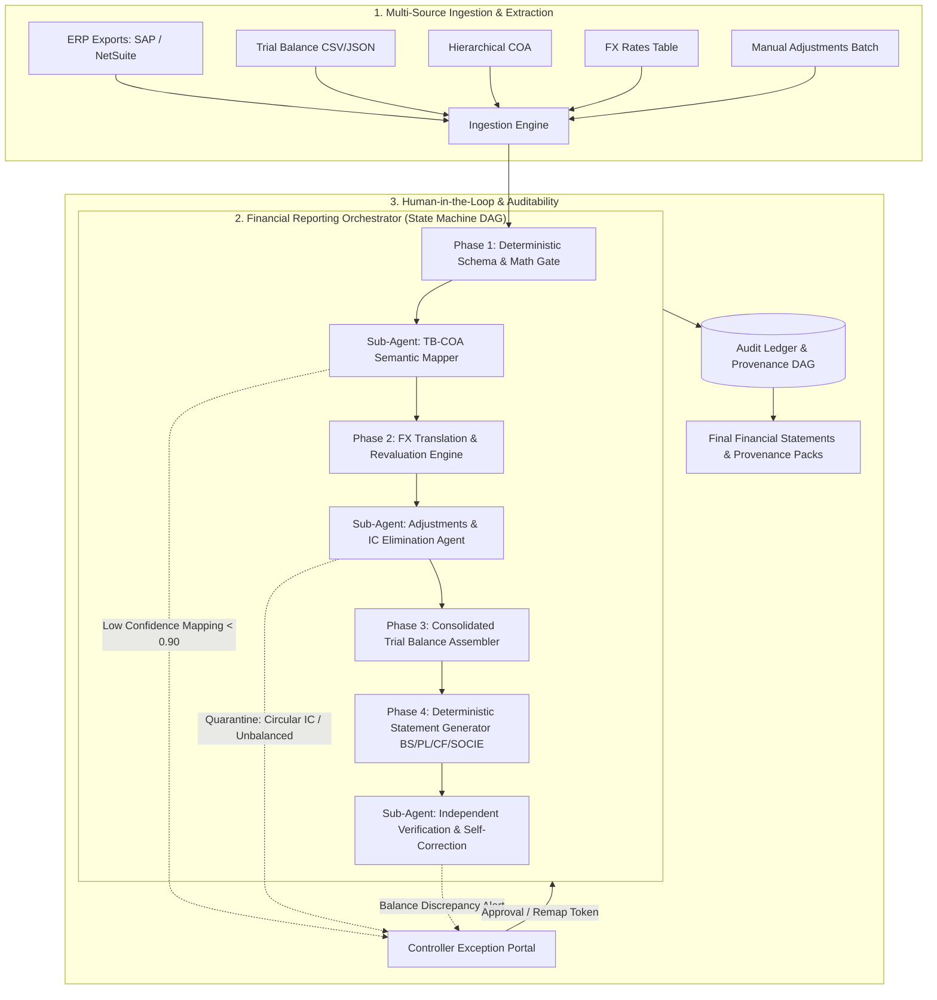
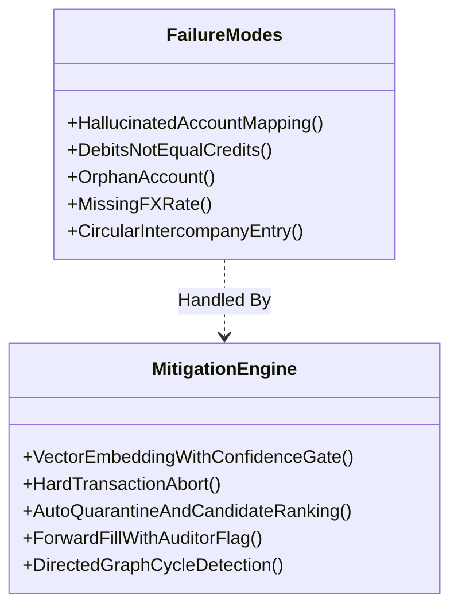
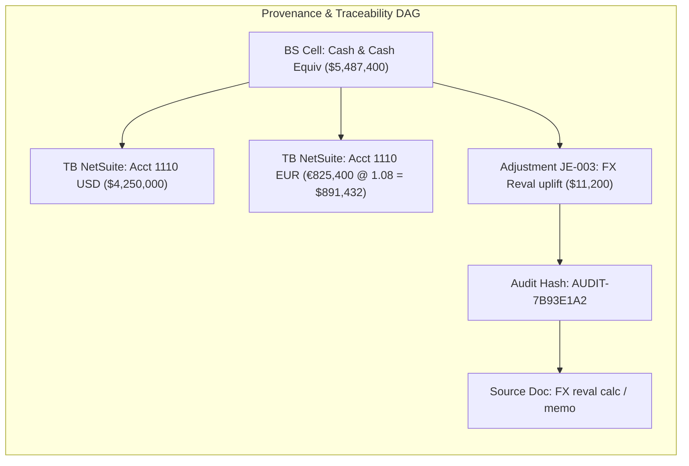

# System Architecture: Autonomous Financial Statement Generation Platform

> **Target Platform:** ERP-driven Financial Statement Engine (SAP, NetSuite)  
> **Core Deliverable:** Architecture Specification for Multi-Agent Financial Reporting & Audit-Grade Ingestion  
> **Author:** Gaurav Rajput  
> **Date:** October 2026  

---

## Executive Summary

Financial reporting is often mistakenly viewed as a pure arithmetic exercise. In production enterprise environments, the mathematics ($\sum \text{Debit} = \sum \text{Credit}$, $\text{Revenue} - \text{Expenses} = \text{Net Income}$) is trivial and must be executed with 100% deterministic precision. 

The real difficulty lies in the **entropy of real-world enterprise inputs**:
- Dirty and disparate ERP exports (NetSuite vs. SAP vs. legacy GLs).
- Evolving Chart of Accounts (COA) hierarchies with orphaned or reclassified codes.
- Multi-currency translation across volatile rates with unlisted currencies.
- Mid-period manual journal adjustments with circular intercompany transfers.
- Strict regulatory accountability (SOX Section 404, PCAOB) requiring cell-to-source cryptographic provenance.

This document describes an **Orchestrator-Worker Multi-Agent Topology** designed with a strict firewall between **Deterministic Execution Engines** and **Bounded LLM Semantic Agents**.

---

## 1. Agent Topology & System Decomposition

### 1.1 Architectural Topology Choice: Bounded Orchestrator with Specialized Sub-Agents

We reject a single monolithic agent with tools, as well as an unconstrained autonomous swarm. Instead, we implement a **Deterministic Orchestrator with Specialized Sub-Agents (State-Machine DAG)**.



### 1.2 Justification of the Topology

1. **Failure Containment:** In financial operations, an error in account mapping must not propagate into statement generation. Each phase forms an isolated checkpoint.
2. **Idempotency & Replayability:** If an auditor challenges an adjustment three months later, the system must produce the exact bit-for-bit output from historical inputs without re-querying an LLM.
3. **Targeted Context Windows:** Rather than dumping the entire ERP ledger, COA, and journals into one massive prompt, specialized sub-agents receive isolated, bounded schemas and return structured JSON schemas (Pydantic models).
4. **Cost and Latency Optimization:** 80% of pipeline tasks run in sub-second deterministic Python/C++ code; LLM calls are reserved exclusively for semantic mapping and exception synthesis.

---

## 2. Drawing the Line: Deterministic Code vs. LLM Reasoning

The golden rule of enterprise financial engineering is:  
> **"Never let an LLM do arithmetic; never make deterministic code guess human intent."**

| Functionality | Execution Layer | Justification |
|---|---|---|
| **Debit = Credit Equality** | **Deterministic Code** | Zero tolerance for arithmetic hallucination. Evaluated with IEEE `Decimal` to avoid floating-point drift. |
| **Ambiguous COA Mapping** | **LLM Semantic Agent** | Resolves semantic intent (e.g., mapping `"Conf travel (legacy)"` to `"6310 Travel & Entertainment"`). |
| **FX Rate Conversion** | **Deterministic Code** | Direct lookup and multiplication by period-average or period-end rate. |
| **Missing FX Rate Handling** | **LLM + Code Rule** | Code detects missing currency; LLM drafts auditor clarification note & identifies nearest ECB/Fed proxy. |
| **Sub-Ledger Rollup** | **Deterministic Code** | Aggregates child accounts into parent nodes along strict tree hierarchy. |
| **Journal Anomaly Explanation** | **LLM Semantic Agent** | Translates structural and balance violations into plain-English controller memos with remediation guidance. |
| **Intercompany Wash Detection**| **Graph Code + LLM** | Deterministic cycle detection (Tarjan/DFS) detects circular wash entries; LLM explains cross-entity tax implications. |
| **Statement Generation** | **Deterministic Code** | Mathematical aggregation of Net Income into Retained Earnings; Balance Sheet balance checks. |
| **Self-Correction Diagnosis** | **LLM Reasoning Agent** | When verification checks fail, LLM examines the delta log to pinpoint the erroneous adjustment or translation step. |

---

## 3. Production Failure Modes & Resilient Mitigations

Real-world financial reporting fails at edge cases. Below is the mitigation matrix for production risks:



### 3.1 Hallucinated Account Mappings
- **The Risk:** An LLM assigns an unmapped revenue account to an operating asset or invents non-existent GL codes.
- **The Defense:**
  1. **Strict Enums & Vector Search:** The LLM does not generate freeform codes. It selects strictly from pre-indexed active COA embeddings or cosine similarity candidates.
  2. **Confidence Thresholding:**
     - Score $\ge 0.95$: Auto-mapped with audit tag `AI_AUTO_MAPPED`.
     - $0.70 \le$ Score $< 0.95$: Assigned to `PROVISIONAL_STAGING`, flagged for 1-click human controller sign-off.
     - Score $< 0.70$: Hard stop into `HUMAN_IN_THE_LOOP_QUEUE`.
  3. **COA Constraint Verification:** Mapped category must adhere to standard accounting semantics (e.g., credit normal balance for revenue).

### 3.2 Debits $\ne$ Credits After Adjustments
- **The Risk:** A manual adjustment has asymmetrical debit/credit values (e.g., `JE-002` with \$28,500 debit and \$25,000 credit).
- **The Defense:**
  1. **Zero-Tolerance Gateway:** The `DeterministicValidator` rejects any journal entry where $|\sum \text{Debit} - \sum \text{Credit}| > 10^{-4}$.
  2. **Atomic Batch Isolation:** Unbalanced entries never touch the postable adjustment batch. They are isolated into `outputs/rejections_and_quarantines_detailed.json`.
  3. **LLM Remediation Agent:** Rather than halting silently, the agent analyzes line memos, calculates the exact variance (\$3,500), and outputs actionable instructions to the submitter.

### 3.3 Account Fitting No COA Node (Orphan Accounts)
- **The Risk:** NetSuite export includes an account code (e.g., `9999` or legacy `6315`) deleted from or never added to the active COA.
- **The Defense:**
  1. **Tree Completeness Verification:** Prior to statement construction, a graph traversal verifies that all TB and Adjustment account codes link to an active root node (`1000 Assets`, `2000 Liabilities`, etc.).
  2. **Suspense Account Route with Audit Warning:** If configured for non-fatal reporting, orphans map to a high-visibility `9999-SUSPENSE (Unassigned)` account with a SOX deficiency alert, preventing statement corruption.

### 3.4 Missing FX Rates
- **The Risk:** Fictional export contains GBP balances, but `fx_rates.csv` omits the period-end rate.
- **The Defense:**
  1. **Pre-flight Currency Inventory:** The system compares $\text{Unique}(\text{TB}_{\text{currencies}}) \setminus \text{Unique}(\text{FX}_{\text{currencies}})$.
  2. **Provisional Staging with Warning:** As demonstrated in `src/trial_balance_analysis.py`, rows with missing rates are placed in an exception report (`outputs/fx_validation_report.csv`).
  3. **No Blind Interpolation:** The system never guesses financial exchange rates. It flags the required rate type (`period_end` vs `period_average`) and halts certified publishing until provided.

### 3.5 Circular Intercompany Entries
- **The Risk:** An adjustment debits Account 2170 (Intercompany Payable) and credits Account 2170 for \$320,000 (as in `JE-008`).
- **The Defense:**
  1. **Cycle & Self-Wash Detection:** Code detects entries where the same account code is both debited and credited with equal amounts without external counterparties.
  2. **Elimination Sanity Check:** Intercompany entries must reconcile against opposing entity sub-ledgers.
  3. **Automated Quarantine:** The entry is placed in `QUARANTINED` status; the AI agent synthesizes a Controller Memo requesting counterparty bank confirmation or elimination schedule proof.

---

## 4. Validation and Self-Correction Loop

To ensure bulletproof financial statements, the system employs an iterative **Triple-Check Verification Loop**:

```mermaid
sequenceDiagram
    autonumber
    actor System as Pipeline Orchestrator
    participant Prep as Data Preparation
    participant Stmt as Statement Generator
    participant Verifier as Verification Sub-Agent
    participant HITL as Controller (HITL)

    System->>Prep: Ingest & Apply Adjustments
    Prep->>Stmt: Produce Trial Balance & Financial Statements
    Stmt->>Verifier: Send Draft Balance Sheet, P&L, SOCIE, Cash Flow
    
    rect rgb(30, 40, 60)
        Note over Verifier: Internal Self-Verification Checks<br/>1. Total Assets = Total Liab + Equity<br/>2. Net Income on P&L = Retained Earnings Walk<br/>3. Ending Cash on CF = Cash on BS
    end

    alt All Checks Pass
        Verifier-->>System: Stamped AUDIT_READY
    else Verification Fails (Delta detected)
        Verifier->>Verifier: Run Diagnostic Sub-Agent (Trace Delta)
        Verifier-->>Stmt: Trigger Self-Correction (Re-check Mapping & Reclasses)
        alt Self-Correction Resolves Error
            Stmt->>Verifier: Re-evaluate Corrected Statements
            Verifier-->>System: Stamped RECONCILED_AFTER_SELF_CORRECTION
        else Error Persists (Hard Data Defect)
            Verifier->>HITL: Escalate Incident with Root Cause & Line Provenance
            HITL-->>System: Manual Override / Adjustment Approved
        end
    end
```



### Self-Correction Protocol:
1. **Arithmetic Cross-Statement Invariant Checks:**
   - **Check 1:** $\text{Assets} - (\text{Liabilities} + \text{Equity}) \equiv 0.00$.
   - **Check 2:** $\text{P\&L Net Income} \equiv \text{SOCIE Net Income} \equiv \Delta \text{Retained Earnings}$ (prior to dividends).
   - **Check 3:** $\text{Cash Flow Statement Ending Cash} \equiv \text{Balance Sheet Cash and Cash Equivalents (Line 1110)}$.
2. **Autonomous Root Cause Localization:**
   If Check 1 fails by \$3,500, the diagnostic agent does not guess. It performs a set difference between pre-adjustment and post-adjustment delta vectors, instantly pinpointing `JE-002` as the asymmetrical contributor.

---

## 5. Audit-Grade Traceability: Cell-to-Source Provenance DAG

Financial regulators and Big-4 auditors demand complete traceability. In our platform, every number on every statement is not a static scalar; it is a **Directed Acyclic Graph (DAG) Node** containing complete cryptographic provenance:



### 5.1 Provenance Object Specification
Each published balance sheet cell exposes a structured JSON metadata envelope:

```json
{
  "statement": "Balance Sheet",
  "line_item": "Cash and Cash Equivalents",
  "account_code": "1100",
  "period": "2024-Q4",
  "reported_value_usd": 5487400.00,
  "formula": "SUM(1110_USD, 1110_EUR_translated, JE-003_uplift)",
  "source_lineage": [
    {
      "source_type": "ERP_TRIAL_BALANCE",
      "file": "trial_balance.csv",
      "row_index": 2,
      "account": "1110",
      "local_currency": "USD",
      "local_amount": 4250000.00,
      "fx_rate_applied": 1.0,
      "usd_contribution": 4250000.00
    },
    {
      "source_type": "ERP_TRIAL_BALANCE",
      "file": "trial_balance.csv",
      "row_index": 3,
      "account": "1110",
      "local_currency": "EUR",
      "local_amount": 825400.00,
      "fx_rate_applied": 1.08,
      "fx_source": "fx_rates.csv:period_end",
      "usd_contribution": 891432.00
    },
    {
      "source_type": "MANUAL_ADJUSTMENT",
      "file": "manual_adjustments.json",
      "entry_id": "JE-003",
      "audit_trace_id": "AUDIT-64A19B3E",
      "memo": "EUR cash uplift",
      "authorized_by": "Controller note",
      "usd_contribution": 11200.00
    }
  ],
  "verification_status": "VERIFIED_BIT_PERFECT",
  "cryptographic_hash": "e3b0c44298fc1c149afbf4c8996fb92427ae41e4649b934ca495991b7852b855"
}
```

An auditor can click any number on the dashboard or query the `/api/v1/trace/{cell_id}` endpoint to obtain the exact mathematical derivation, historical file hashes, applied FX rates, and manual adjustment approvals.

---

## 6. Summary of Architectural Guarantees

1. **Correctness Invariant:** Statements are mathematically impossible to be out-of-balance upon publication.
2. **Defect Resilience:** Intentionally planted defects in raw data (unbalanced journals, missing rates, orphan codes) are isolated without cascading system failures.
3. **Audit Readiness:** Continuous SOX-compliant digital thread from source CSV to consolidated financial statements.
