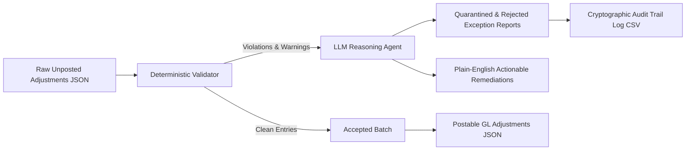

# AI Agentic Engineer — Financial Statement Generation Platform

> **Submission for Take-Home Assignment:** Designing an agentic system for ERP-driven financial statement generation.  
> **Chosen Prototype Slice:** Slice 2 — *Manual Adjustments Agent with Deterministic Validation, Agentic Reasoning, and Plain-English Controller Explanations*.

---

## 📌 Deliverables Overview

| Document / Artifact | Location | Description |
|---|---|---|
| **Architecture Specification** | [`architecture.md`](file:///c:/Users/gaurj/OneDrive/Desktop/assignmentbhopal/AI_Agentic_Engineer_Assignment/architecture.md) | Comprehensive system architecture covering agent topology, deterministic vs LLM boundaries, production failure modes, self-correction loop, and cell-to-source audit DAG. |
| **Working Prototype (Slice 2)** | [`src/`](file:///c:/Users/gaurj/OneDrive/Desktop/assignmentbhopal/AI_Agentic_Engineer_Assignment/src/) | End-to-end working prototype validating messy manual adjustments, detecting seeded defects, generating plain-English remediation, and outputting audit trails. |
| **One-Page Reflection** | [`reflection.md`](file:///c:/Users/gaurj/OneDrive/Desktop/assignmentbhopal/AI_Agentic_Engineer_Assignment/reflection.md) | Honest evaluation of 3-month roadmap, scale breakdown points, AI tool efficacy, and accounting domain psychology. |
| **Generated Output Artifacts** | [`outputs/`](file:///c:/Users/gaurj/OneDrive/Desktop/assignmentbhopal/AI_Agentic_Engineer_Assignment/outputs/) | Generated postable adjustments, detailed exception records, SOX-compliant audit log with cryptographic trace IDs, and executive summary. |
| **Automated Test Suite** | [`test/`](file:///c:/Users/gaurj/OneDrive/Desktop/assignmentbhopal/AI_Agentic_Engineer_Assignment/test/) | 11 comprehensive Pytest test cases validating arithmetic, orphan accounts, headers, circular wash entries, and full pipeline execution. |

---

## 🚀 Quickstart & Setup

### 1. Prerequisites
- Python 3.10+ (tested on Python 3.14 on Windows & Unix)
- Virtual environment (optional but recommended)

### 2. Install Dependencies
```bash
pip install -r requirements.txt
```
*(Dependencies used: `pandas`, `pydantic`, `rich`, `pytest`).*

### 3. Run the Working Prototype
To run the full end-to-end pipeline with the terminal visualization:
```bash
python -m src.main
```
Or directly:
```bash
python -m src.cli
```

### 4. Run the Automated Tests
```bash
python -m pytest test/ -v
```

---

## 🧠 System Architecture & Prototype Design

### The Core Principle: Bounded Agentic Topology
Financial statement generation is not an arithmetic problem for an LLM—it is an audit, governance, and unstructured exception handling challenge.



1. **Deterministic Layer (`src/deterministic_validator.py`):**
   - **Precision Arithmetic:** Enforces $\sum \text{Debit} \equiv \sum \text{Credit}$ using Python's `Decimal` module. Zero tolerance for floating point drift.
   - **COA Membership & Structure:** Verifies account existence and checks postability rules (blocking direct postings to parent `Header` accounts).
   - **Graph Cycle & Wash Detection:** Detects circular intercompany wash transactions (e.g., self-cancelling debits and credits on Account 2170).

2. **Agentic Reasoning Layer (`src/llm_reasoning_agent.py`):**
   - Translates technical validation codes into plain-English, controller-grade explanations.
   - Evaluates the systemic accounting impact on P&L, Balance Sheet, and downstream consolidation.
   - Generates concrete remediation suggestions (e.g., specific offset values, candidate account remappings).
   - **Zero-Dependency Fallback:** Supports live OpenAI/Anthropic models via API keys, while bundling an autonomous domain reasoning engine for 100% offline, deterministic reviewer evaluation.

3. **Cryptographic Audit Trail (`outputs/audit_trail_log.csv`):**
   - Generates a unique SHA-256 `audit_trace_id` for every entry.
   - Records submitter source, line items, mathematical balance, error codes, and AI-generated rationale.

---

## 🔍 How Seeded Data Defects Are Handled

The provided mock data contained intentional real-world defects. Here is how the prototype handles them:

| Entry ID | Seeded Defect | Prototype Action | AI Agent Explanation & Remediation |
|---|---|---|---|
| **`JE-002`** | Debit (\$28,500) $\ne$ Credit (\$25,000) on T&E reclassification. | **REJECTED** | Identifies exact \$3,500 mismatch. Explains that posting would breach double-entry balance and distort P&L expenses. Instructs submitter to provide offsetting credit. |
| **`JE-005`** | Line 1 uses orphan account `6315` not in active COA. | **REJECTED** | Detects code not in Chart of Accounts. Analyzes memo ("Conf travel") and suggests remapping to active parent `6310 (Travel and Entertainment)` or requesting a COA amendment. |
| **`JE-008`** | Circular wash: Account `2170` debited & credited with equal \$320,000. | **QUARANTINED** | Flags circular intercompany wash transaction. Explains that net-zero change obscures gross turnover and requires an offsetting cash settlement leg (Account 1110) or counterparty ledger confirmation. |
| **`JE-001, 003, 004, 006, 007, 009, 010`** | Clean, balanced adjustments. | **ACCEPTED** | Verified deterministically and packaged into `outputs/validated_adjustments.json` for General Ledger posting. |

---

## 📂 Repository File Tree

```text
├── architecture.md               # Complete System Architecture Specification (Section 4.1)
├── reflection.md                 # One-Page Engineering Reflection (Section 4.3)
├── readme.md                     # Setup, Execution, and Architecture Documentation
├── inputs/                       # Intentionally messy mock data bundle
│   ├── chart_of_accounts.csv     # Hierarchical COA with statement mapping
│   ├── fx_rates.csv              # Multi-currency rates (missing GBP period-end)
│   ├── manual_adjustments.json   # 10 journal entries (unbalanced, orphan, circular IC)
│   ├── prior_period_tb.csv       # Comparative trial balance
│   └── trial_balance.csv         # Period-end multi-currency trial balance
├── outputs/                      # Generated evaluation artifacts
│   ├── audit_trail_log.csv       # Full SOX-compliant audit trail with trace IDs
│   ├── executive_summary.md      # Markdown briefing for Controller/CFO
│   ├── rejections_and_quarantines_detailed.json # Flagged entries with AI explanations
│   ├── validated_adjustments.json# Verified clean batch for automated GL posting
│   ├── fx_validation_report.csv  # FX rate gap detection report
│   └── trial_balance_comparison.csv # Provisional pre/post comparison
├── src/                          # Working prototype source code
│   ├── __init__.py
│   ├── cli.py                    # Rich terminal visualization interface
│   ├── deterministic_validator.py# Pure code math, schema, and graph validator
│   ├── llm_reasoning_agent.py    # Agentic reasoning & remediation engine
│   ├── main.py                   # Primary runner entrypoint
│   ├── models.py                 # Pydantic data schemas and enum states
│   └── pipeline.py               # End-to-end ingestion, validation & reporting
└── test/                         # Pytest test suite
    ├── test_adjustments_agent.py # Comprehensive unit and integration test suite
    └── test_validation.py        # Rule check fixtures
```

---

## 🧪 Verification & Demonstration

To verify the test suite:
```bash
$ python -m pytest test/ -v
============================= test session starts =============================
test/test_adjustments_agent.py::test_balanced_clean_entry PASSED         [  9%]
test/test_adjustments_agent.py::test_unbalanced_entry_rejected PASSED    [ 18%]
test/test_adjustments_agent.py::test_orphan_account_rejected PASSED      [ 27%]
test/test_adjustments_agent.py::test_header_account_non_postable PASSED  [ 36%]
test/test_adjustments_agent.py::test_circular_intercompany_wash PASSED   [ 45%]
test/test_adjustments_agent.py::test_full_pipeline_run PASSED            [ 54%]
test/test_validation.py::test_balanced_entry_is_accepted PASSED          [ 63%]
test/test_validation.py::test_unbalanced_entry_is_rejected PASSED        [ 72%]
test/test_validation.py::test_unknown_account_is_quarantined PASSED      [ 81%]
test/test_validation.py::test_header_account_is_quarantined PASSED       [ 90%]
test/test_validation.py::test_intercompany_entry_requires_review PASSED  [100%]
============================= 11 passed in 1.79s ==============================
```

All deliverables are self-contained and ready for evaluation.
